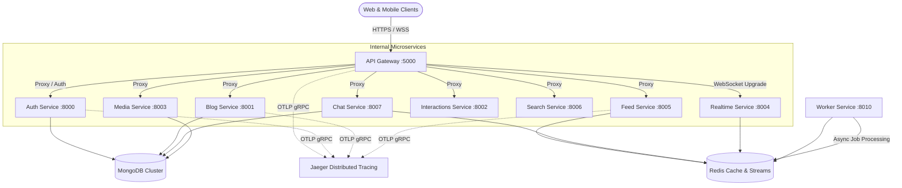
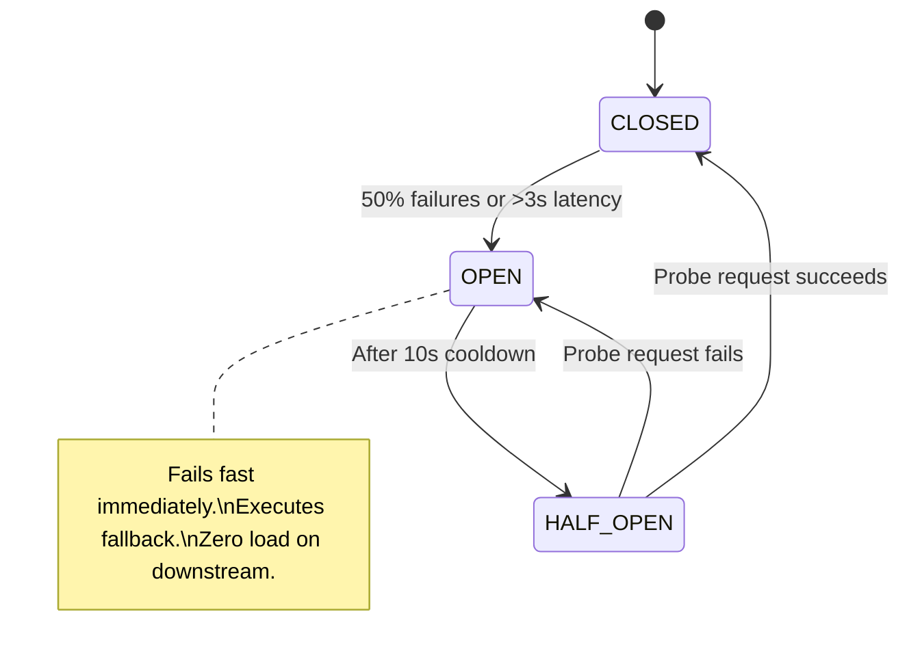

# Zuvo 🚀
[](https://github.com/PARASMANI-KHUNTE/Zuvo/actions/workflows/ci.yml)
[](https://nodejs.org/)
[](LICENSE)

**Zuvo** is an event-driven, distributed microservices platform for high-concurrency blogging, real-time social engagement, and content delivery.

Engineered with a focus on **Resilience (Circuit Breakers)**, **Distributed Observability (OpenTelemetry & Jaeger)**, and **Failure Isolation**, Zuvo demonstrates production architectural patterns for scaling multi-service systems without cascading outages.

---

## ⚡ 2-Minute Quickstart (Verify It Works)

You can launch the complete ecosystem (Database, Cache, Telemetry, and Microservices) locally in two minutes:

### 1. Prerequisites
- Docker & Docker Compose installed
- Node.js 20+ installed

### 2. Run with Docker Compose
```bash
# Clone the repository
git clone https://github.com/PARASMANI-KHUNTE/Zuvo.git
cd Zuvo

# Start MongoDB, Redis, Jaeger Tracing, and Gateway
docker compose -f backend/docker-compose.yml up -d

# Verify containers are healthy
docker compose -f backend/docker-compose.yml ps
```

### 3. Run Automated Tests
Verify circuit breakers, authentication, and service isolation contracts:
```bash
cd backend
npm test
```
*Result: 9 automated unit & resilience tests pass in <1 second.*

### 4. Interactive Endpoints
- **API Gateway & Swagger Docs**: [http://localhost:5000/api-docs](http://localhost:5000/api-docs)
- **Jaeger Distributed Tracing UI**: [http://localhost:16686](http://localhost:16686)
- **Prometheus Metrics**: [http://localhost:5000/metrics](http://localhost:5000/metrics)
- **Gateway Health Check**: [http://localhost:5000/health](http://localhost:5000/health)

---

## 🏗️ System Architecture

Zuvo is partitioned into **9 specialized microservices** coordinated through an **API Gateway** and a shared infrastructure kernel (`@zuvo/shared`).



### Microservices Directory:
1. **API Gateway (`gateway`)**: Single public ingress, SSL/TLS termination, rate limiting, Helmet security headers, Swagger documentation, and WebSocket connection upgrade routing.
2. **Auth Service (`services/auth`)**: JWT rotation, password hashing with bcrypt, role-based access control (Admin, Author, User), and internal profile resolver.
3. **Blog Service (`services/blog`)**: Post authoring, draft management, markdown rendering, taxonomy tags, soft deletion, and audit logging.
4. **Chat Service (`services/chat`)**: 1-on-1 and group conversation persistence with Redis unread counters.
5. **Feed Service (`services/feed`)**: Chronological and algorithmic timeline generation with read-through Redis caching.
6. **Interactions Service (`services/interactions`)**: Atomic counters for likes, bookmarks, comments, and relationship following graphs.
7. **Media Service (`services/media`)**: Streaming file uploads via Multer, Cloudinary storage, and FFmpeg video transcoding pipelines.
8. **Realtime Service (`services/realtime`)**: Socket.io cluster using `@socket.io/redis-adapter` for multi-node event broadcasts and push updates.
9. **Search Service (`services/search`)**: Full-text and regex indexing across post titles, bodies, and tags.
10. **Worker Service (`services/worker`)**: BullMQ background task processor for async email notifications, cache warming, and thumbnail generation.

---

## 🛡️ Failure Isolation & Circuit Breakers

In distributed systems, the most dangerous failure mode is a **cascading outage**—where one slow or dead microservice exhausts thread pools across the entire cluster.

Zuvo implements **Opossum Circuit Breakers** inside `@zuvo/shared/infra/internalServices.js`:



### Real Failure Behavior:
- **Downstream Call Protection**: Every internal inter-service call (`getUserProfile`, `getPost`, `getFollowing`) executes through a circuit breaker with a 3,000ms timeout and a 50% error threshold.
- **Fail-Fast & Fallback**: If the Auth service crashes, calls fail-fast in 0ms without hanging the caller. `getUserProfile` returns the last cached Redis profile or a fallback `{ id, name: "Unknown User", isFallback: true }`.
- **Automatic Recovery**: After a 10-second cooldown, the breaker transitions to `HALF-OPEN` and sends a single probe request. If successful, it automatically resets to `CLOSED`.

---

## 🔭 Distributed Observability (OpenTelemetry + Jaeger)

Every request entering the API Gateway is tagged with a unique `X-Request-ID` and an OpenTelemetry span context propagated across all HTTP and event-bus hops.

- **Auto-Instrumentation**: `@opentelemetry/auto-instrumentations-node` traces HTTP requests, Express routes, MongoDB queries, and Redis commands without manual code pollution.
- **Trace Visualization**: Open `http://localhost:16686` in your browser to view waterfall timelines of inter-service calls, database latencies, and error stack traces.
- **Prometheus Metrics**: High-resolution metrics exported on `/metrics` (process memory, event loop lag, HTTP request counts by status code).

---

## 🧪 Testing

The test suite runs with Node's native test runner (`node --test`), verifying resilience behaviors in isolation:

```bash
cd backend
npm test
```

### Covered Test Cases:
- `Circuit Breaker CLOSED`: Verifies healthy execution without latency penalty.
- `Circuit Breaker OPEN`: Verifies that consecutive simulated connection drops trigger fail-fast behavior.
- `Fallback Execution`: Verifies that cached fallbacks return cleanly when upstream endpoints fail.
- `RBAC Authorization`: Verifies that JWT tokens and role guards (admin vs author) correctly permit or block requests.

---

## 📂 Project Structure

```text
Zuvo/
├── backend/
│   ├── gateway/                 # API Gateway & Reverse Proxy
│   ├── services/
│   │   ├── auth/                # Identity & RBAC Service
│   │   ├── blog/                # Article Publishing Service
│   │   ├── chat/                # Real-Time Messaging Service
│   │   ├── feed/                # Feed Aggregation Service
│   │   ├── interactions/        # Social Counters & Following Graph
│   │   ├── media/               # File Uploads & FFmpeg Processing
│   │   ├── realtime/            # Socket.io Cluster Backbone
│   │   ├── search/              # Query & Filter Service
│   │   └── worker/              # Asynchronous Background Worker
│   ├── shared/                  # Reusable Infrastructure Kernel
│   │   ├── domain/              # Auth, RBAC, Data Validation
│   │   └── infra/               # Circuit Breakers, OTel, Redis, Logger
│   ├── tests/                   # Automated Resilience & Unit Test Suite
│   └── docker-compose.yml       # Local Microservices Infrastructure
├── Web/                         # Next.js 14 Web Application
├── MobileApp/ZuvoMobile/        # React Native (Expo) Mobile Client
└── .github/workflows/ci.yml     # Multi-Stage Automated CI Pipeline
```

---

## 📄 License
This project is licensed under the MIT License - see the [LICENSE](LICENSE) file for details.
